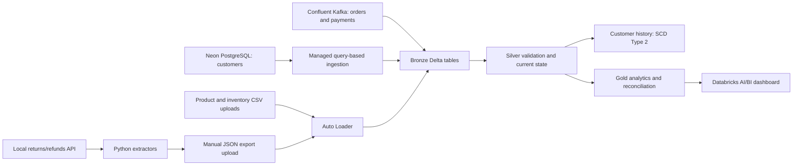

# Retail operations lakehouse

A portfolio data engineering project combining Kafka order/payment events,
PostgreSQL customer data, supplier CSV files, and simulated returns/refunds API
exports in Databricks. Bronze retains source data, Silver validates and builds
current state, and Gold supports reconciliation and analytics.

## Architecture

## Repository

- `notebooks/`: notebooks 02–13, with outputs and execution metadata removed.
- `producer/`: original local scripts, synthetic CSV/payment fixtures, and API exports.
  Files stay together because scripts resolve sibling files by path.
- `sql/`: reconstructed PostgreSQL setup and synthetic customer seed.
- `jobs/`: sanitized job template; requires workspace-specific configuration.
- `requirements.txt`: local Python dependency, not the Databricks runtime environment.

## Setup sequence

1. Provision Databricks with Unity Catalog and a compatible serverless environment.
   Create catalog `retail_operations_dev`, schemas `bronze`, `silver`, `gold`, and
   `operations`, and managed volumes `bronze.supplier_files` and
   `operations.streaming_checkpoints`. API notebooks create `bronze.api_files`.
   Several notebooks hardcode the default catalog, so changing a widget alone
   does not retarget the whole project.
2. For a new Neon demo database, follow `sql/README.md`. Configure the customer
   ingestion connection and pipeline for `neondb.retail.customers`, primary key
   `customer_id`, cursor `updated_at`, and destination
   `retail_operations_dev.bronze.customers_raw`.
3. Create Confluent topics `orders` and `payments`. Configure producer permissions
   and a separate Databricks consumer connection. Configure Kafka ingestion into
   `bronze.orders_raw` and `bronze.payments_raw`, preserving binary `key` and `value`.
   This Kafka ingestion pipeline runs separately from the supplied refresh job.
4. Create a local Python environment and install `requirements.txt`. Scripts
   prompt for Kafka credentials; do not put credentials in source control.
   Review each producer before running: these send real messages to your topics.
   `producer_test.py` generates a new order ID, while several scenario scripts
   reference fixed historical IDs. Adapt related order/payment/return/refund IDs
   together for a fresh deployment. Supplied fixtures are not a guaranteed
   one-command replay into an empty environment.
5. Upload product CSVs to `/Volumes/retail_operations_dev/bronze/supplier_files/products`
   and inventory CSVs to the corresponding `inventory` directory. Existing
   October 2026 snapshot timestamps can intentionally produce stale-data flags.
6. In one local terminal run `python producer/returns_api.py`. In another run
   `python producer/extract_returns.py` and `python producer/extract_refunds.py`.
   Upload the resulting line-delimited JSON files to
   `/Volumes/retail_operations_dev/bronze/api_files/returns` and `refunds`.
   The cloud workspace cannot reach this localhost API directly.
7. Import notebooks under `/Workspace/Shared/retail-project/notebooks`. Replace
   the customer pipeline ID in `jobs/retail_refresh.template.json`. Review compute,
   paths, permissions, and notifications before creating the job. Its daily
   trigger is deliberately paused in this distribution. Keep fixture tests off
   during scheduled execution.
8. Run upstream ingestion, then the refresh job. Check every task and notebook 09's
   final checks before enabling the schedule. Configure dashboard datasets from
   Gold tables/views; the dashboard definition is not included in this package.

## Processing and checks

Orders and payments validate payloads, deduplicate deliveries, stop on conflicting
event IDs before their Silver writes, and select the latest business version.
Other checks cover customer uniqueness, inventory quantities, return references
and quantity limits, refund references and capacity, and preservation of rows and
amounts through joins and aggregates. Notebook 13 maintains observed customer
profile history. Notebook 09 checks the published datasets after upstream tasks.

The job template preserves the original 13-task dependency graph. PostgreSQL
ingestion precedes customer validation. Orders precede payment, product, and
return processing. Refund processing waits for payments and returns. Final checks
wait for customer analytics/history, reconciliation, inventory, returns, and refunds.

## Validation status and limitations

- Notebook Python syntax and producer Python syntax were checked locally. JSON
  files parse, and all job notebook/dependency references resolve in this package.
- The user reported earlier successful Databricks runs. The newest conflict-guard
  edits have not been independently executed against Databricks in this review.
- Local HTTP integration testing was blocked by the review environment's socket
  permissions. Kafka and Neon integration were not executed during packaging.
- PostgreSQL scripts are reconstructed, not exports of the original database.
- API extraction/upload is manual, and the extractors reject pagination rather
  than silently exporting a partial result. The API is a local synthetic demo.
- Query-based customer capture is not a full change log; customer history records
  observed changes rather than every source transaction. Analytics use current
  customer/product attributes, not historical as-of joins.
- Silver snapshot merges require the complete retained source history. Do not
  replace their sources with individual incremental batches without redesigning
  deletion behavior. Conflicting source history requires explicit remediation.
- Table writes are not one transaction across the entire job. A later failure
  does not roll back earlier tasks. Allowed return/refund statuses do not enforce
  every possible lifecycle transition.
- The demo validates GBP amounts. Ordered merchandise value is not recognized
  revenue, and captured amounts minus refunds are not profit. Returns do not
  automatically restock inventory.
- No dashboard export, managed ingestion pipeline definitions, pinned local
  dependency lockfile, or notebook 01 was supplied. Infrastructure setup remains
  partly manual. This is a portfolio package, not a production deployment bundle.
